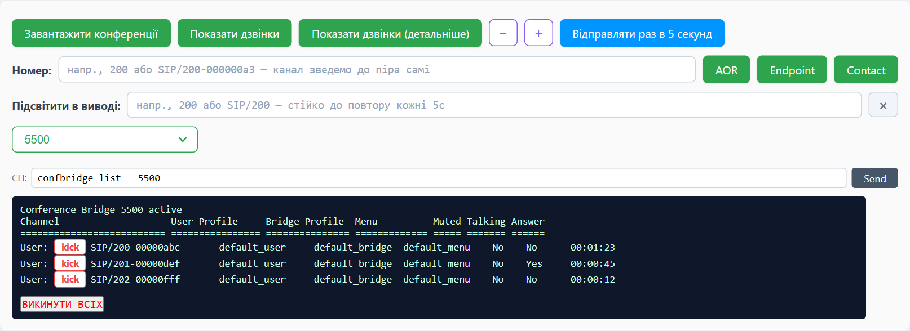
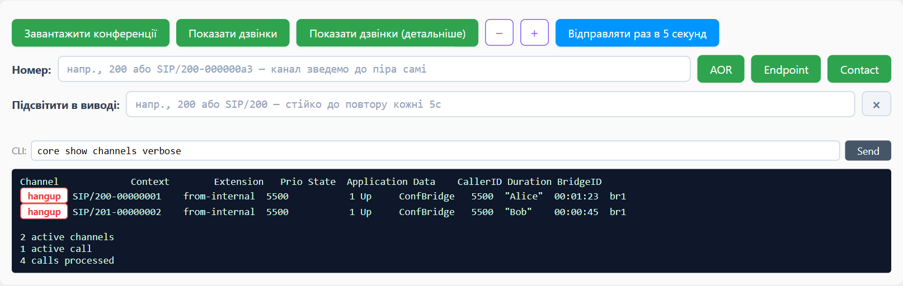

# Астеріск для лінивих

Розширення для Chrome, яке додає кнопки на сторінку Asterisk CLI у FreePBX. Замість того щоб набирати `confbridge list`, `confbridge kick` чи `channel request hangup` руками — один клік.



## Що вміє

- **Конференції** — активні конференції у випадаючому списку, учасники вибраної, `kick` біля кожного й «Викинути всіх».
- **Дзвінки** — `core show channels`; у детальному вигляді біля кожного каналу кнопка `hangup`.
- **Номер** — `pjsip show aor`, `endpoint` і `contact` для внутрішнього номера. Можна вставити канал на кшталт `SIP/200-000000a3` — номер з нього витягнеться сам.
- **Підсвітка** — виділяє потрібний текст у виводі й не злітає під час повтору.
- **Повтор** — надсилає поточну команду кожні N секунд (кнопки `−` / `+`), щоб стежити за дзвінками наживо.



## Встановлення

1. Завантаж `lazy-asterisk-0.2.zip` з [Releases](https://github.com/kazapanama/lazy-asterisk/releases/latest) і розпакуй (або склонуй репозиторій).
2. Відкрий `chrome://extensions` (в Edge — `edge://extensions`) і ввімкни «Режим розробника».
3. «Завантажити розпаковане розширення» → вибери папку.

Розширення вмикається саме на сторінці `…/admin/config.php?display=cli` будь-якої АТС.

## Розробка

```sh
npm install
npm test             # Vitest + jsdom
visual-tests.bat     # мок-сторінка FreePBX у браузері з готовими сценаріями
```
